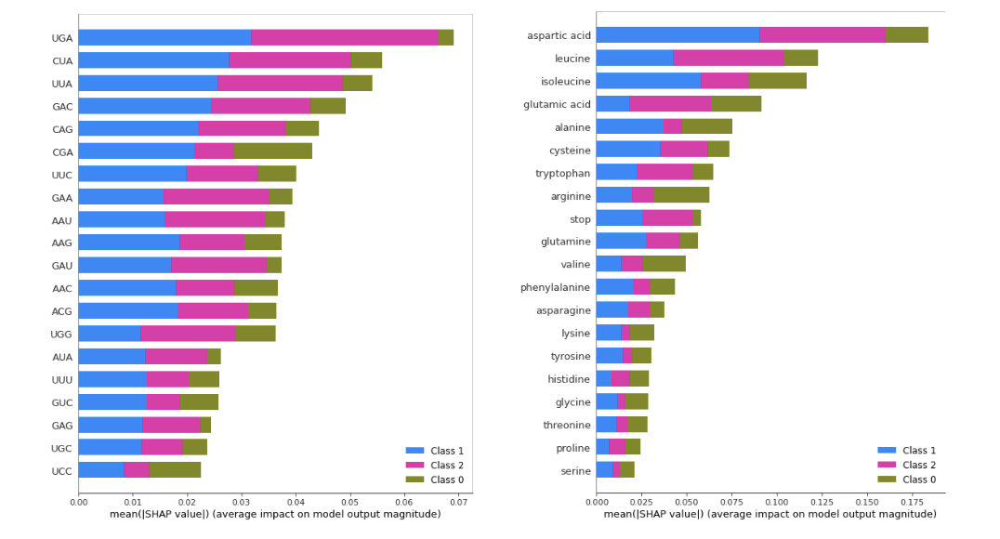
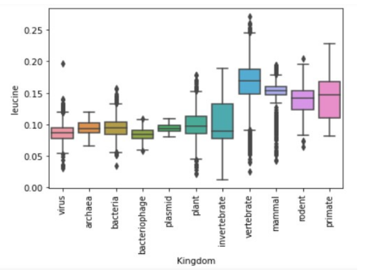

# Codon Usage Analysis: Predicting Taxonomic Groups and DNA Types

A machine learning analysis of codon usage patterns to predict taxonomic classification and DNA type using multiple algorithms including k-Nearest Neighbors, Random Forest, XGBoost, Multi-Layer Perceptron, and Naive Bayes.

## Project Overview

This project replicates and extends the findings of Khomtchouk (2020) on using codon frequency analysis for taxonomic prediction. The study demonstrates that both taxonomic group and DNA type can be predicted with high accuracy from simple frequency analysis of codons in DNA samples.

**Key Innovation**: This analysis extends beyond codon frequencies to examine whether amino acid frequencies (derived from the codons) can provide comparable predictive power, potentially offering computational advantages in certain applications.

## Dataset

- **Source**: UCI Machine Learning Repository - Codon Usage Dataset
- **Size**: 13,028 observations with 69 attributes
- **Features**: Relative frequencies of all 64 codons plus organism metadata
- **Targets**: Taxonomic group ('kingdom') and DNA type classification

### Data Preprocessing

- Addressed class imbalance by removing extremely sparse categories
- Created amino acid frequency features from codon data
- Applied 85/15 train-test splits with separate validation sets
- One-hot encoding for categorical variables

For detailed methodology, results, and analysis, see the complete project report: `docs/codon-amino-acid-taxonomy.pdf`

## Installation and Setup

### Option 1: Using pyproject.toml (recommended)
```bash
git clone <repository-url>
cd <repository-name>
python -m venv venv
source venv/bin/activate  # On Windows: venv\Scripts\activate
pip install -e .
```

### Option 2: Using requirements.txt
```bash
git clone <repository-url>
cd <repository-name>
python -m venv venv
source venv/bin/activate  # On Windows: venv\Scripts\activate
pip install -r requirements.txt
```

## Key Findings

### Model Performance Summary

**Best Overall Model**: Multi-Layer Perceptron (MLP) with hyperparameter optimization
- DNA type prediction: F1 = 0.993, ROC-AUC = 0.999
- Taxonomic group prediction: F1 = 0.932, ROC-AUC = 0.995

### Algorithm Comparison

| Algorithm | DNA Type F1 | Kingdom F1 | Runtime | Notes |
|-----------|-------------|------------|---------|-------|
| MLP | 0.993 | 0.932 | ~280s | Best overall performance |
| k-NN | 0.993 | 0.938 | ~3s | Best speed-to-performance ratio |
| Random Forest | 0.989 | 0.852 | ~3s | Consistent, interpretable |
| XGBoost | 0.978 | 0.752 | ~1s | Fast but variable performance |
| Naive Bayes | 0.907 | 0.581 | <1s | Baseline comparison |

### Codon vs Amino Acid Features

- **Codon-based models**: Slightly superior performance across all algorithms
- **Amino acid-based models**: Nearly comparable results with 67% fewer features
- **Practical implication**: Amino acid frequencies offer a viable alternative for applications where computational efficiency is prioritized

## Technical Approach

### Machine Learning Pipeline
1. **Exploratory Data Analysis**: Distribution analysis, correlation matrices, PCA
2. **Feature Engineering**: Conversion of codon frequencies to amino acid frequencies
3. **Model Training**: Five different algorithms with hyperparameter optimization
4. **Evaluation**: Cross-validation with F1-score, accuracy, and ROC-AUC metrics
5. **Feature Importance**: SHAP analysis and Gini impurity rankings

### Hyperparameter Optimization
- Manual tuning for k-NN and Random Forest
- Automated optimization using Hyperopt for XGBoost and MLP
- Validation-based model selection

## Notebooks Description

1. **Notebook 1**: Data loading and initial exploration
2. **Notebook 2**: Exploratory data analysis and visualization
3. **Notebook 3**: Data preprocessing and feature engineering
4. **Notebook 4**: Machine learning model training and evaluation
5. **Notebook 5**: Feature importance analysis and results visualization

## Key Dependencies

- pandas: Data manipulation and analysis
- numpy: Numerical computing
- scikit-learn: Machine learning algorithms
- xgboost: Gradient boosting implementation
- hyperopt: Hyperparameter optimization
- shap: Model interpretability
- matplotlib/seaborn: Data visualization

## Results and Implications

### Biological Insights
- Certain codons (particularly CUA and UGA) show high predictive importance across models

- Taxonomic relationships are reflected in codon usage patterns
- DNA type classification achieves higher accuracy than taxonomic classification

### Methodological Contributions
- Demonstrates amino acid frequencies as viable alternative to codon frequencies

- Validates hyperparameter optimization importance for neural networks
- Provides comprehensive comparison across multiple ML algorithms

## Future Work

- Address anomalous XGBoost hyperparameter optimization results
- Expand analysis to include sparse taxonomic categories
- Implement ensemble methods combining top-performing algorithms
- Investigate correlation patterns between related amino acids and codons

## References

Khomtchouk, B.B. (2020). Codon Usage Bias Levels Predict Taxonomic Identity and Genetic Composition. BioRxiv. doi: 10.1101/2020.10.26.356295

## License

This project is licensed under the MIT License - see the LICENSE file for details.

## Contact

[Stephen Kizlik] - [stephen.kizlik@gmail.com]

Project Link: [github.com/skizlik/codon-amino-acid-taxonomy]
