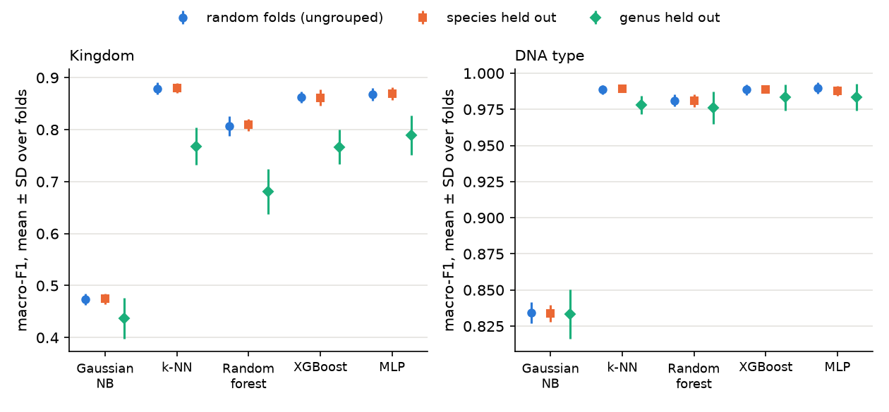
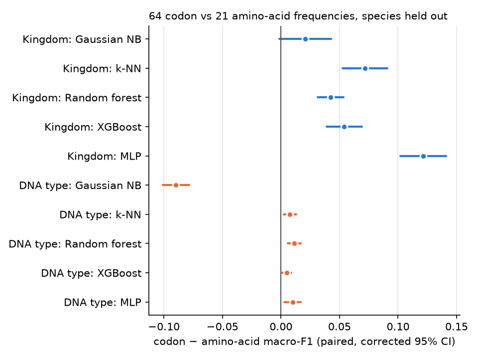
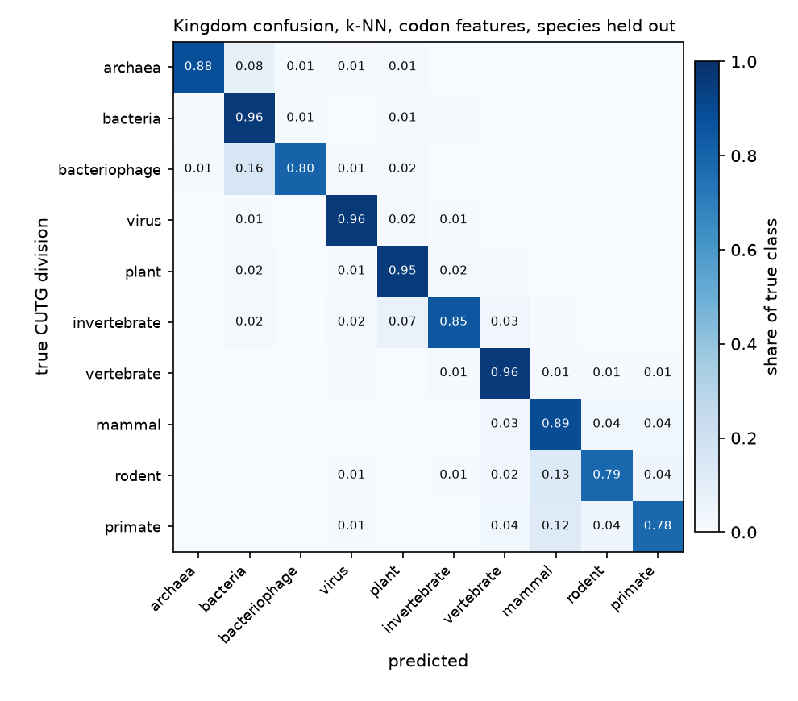

# Codon usage predicts genome compartment almost perfectly, and CUTG division well, until whole genera are held out

[](https://github.com/skizlik/codon-amino-acid-taxonomy/actions/workflows/ci.yml)

Can the 64 codon-usage frequencies of an organism's coding sequences, or the 21 coarser amino-acid
groups derived from them, identify the genome compartment a sequence set came from and the
CUTG division the organism is filed under? Yes for the compartment; mostly for the division. But
how well the division is predicted depends on what the test folds hold out: scores on random folds
describe performance on close relatives of the training organisms, not on new genera.

**Headline** (5-fold cross-validation repeated 3 times, whole species held out from each test fold;
mean ± SD over 15 folds; nested tuning; every number below is read from
[`results/results.json`](results/results.json)):

- **DNA type** (genomic / mitochondrial / chloroplast): macro-F1 **0.989<!--r:summary.species.dna_type.codon.knn.f1_macro.mean--> ± 0.003<!--r:summary.species.dna_type.codon.knn.f1_macro.sd-->** (k-NN, codon
  features). XGBoost reaches 0.989<!--r:summary.species.dna_type.codon.xgb.f1_macro.mean--> ± 0.002<!--r:summary.species.dna_type.codon.xgb.f1_macro.sd-->; the difference is not significant
  (corrected p = 0.74<!--r:tests.species.dna_type.codon.knn_vs_xgb.f1_macro.p_corrected-->).
- **Kingdom** (10 CUTG divisions): macro-F1 **0.880<!--r:summary.species.kingdom.codon.knn.f1_macro.mean--> ± 0.009<!--r:summary.species.kingdom.codon.knn.f1_macro.sd-->**, accuracy
  0.936<!--r:summary.species.kingdom.codon.knn.accuracy.mean--> ± 0.004<!--r:summary.species.kingdom.codon.knn.accuracy.sd--> (k-NN); MLP 0.869<!--r:summary.species.kingdom.codon.mlp.f1_macro.mean--> (corrected p = 0.21<!--r:tests.species.kingdom.codon.knn_vs_mlp.f1_macro.p_corrected-->). Majority-class
  baseline: macro-F1 0.037<!--r:summary.species.kingdom.codon.majority.f1_macro.mean-->, accuracy 0.225<!--r:summary.species.kingdom.codon.majority.accuracy.mean-->.
- **Holding out whole genera** costs 0.065<!--r:leak_range_strong.kingdom.f1_macro_species_minus_genus.min-->–0.128<!--r:leak_range_strong.kingdom.f1_macro_species_minus_genus.max--> kingdom macro-F1 for the four strong models and changes the
  winner: MLP leads with 0.789<!--r:summary.genus.kingdom.codon.mlp.f1_macro.mean--> ± 0.038<!--r:summary.genus.kingdom.codon.mlp.f1_macro.sd-->, while k-NN falls by 0.112<!--r:leak.kingdom.codon.knn.f1_macro_species_minus_genus--> to
  0.768<!--r:summary.genus.kingdom.codon.knn.f1_macro.mean--> ± 0.036<!--r:summary.genus.kingdom.codon.knn.f1_macro.sd-->. Holding out species instead of random rows changes nothing
  (kingdom macro-F1 differences −0.005<!--r:leak_range.kingdom.f1_macro_ungrouped_minus_species.min--> to +0.003<!--r:leak_range.kingdom.f1_macro_ungrouped_minus_species.max-->).



*Figure 1. Same models, same tuning, three ways of building the test folds. Codon features; mean ± SD
over 15 outer folds per scheme.*

## Data

[UCI Codon Usage](https://archive.ics.uci.edu/dataset/577/codon+usage) (Khomtchouk 2020), derived
from the CUTG database: 13,028<!--r:data.n_raw--> rows, one per organism and genome compartment, with 64 codon
frequencies, the CUTG division (`Kingdom`), the compartment (`DNAtype`) and the NCBI taxonomy id
(`SpeciesID`). The file is committed unchanged in `data/raw/`; source, checksum, codebook and license
notes are in [`data/README.md`](data/README.md).

- 2<!--r:data.n_repaired--> rows with commas in the species name are realigned, and their missing trailing codons
  recovered exactly from the codon counts.
- Class filter (as in the original project, now explicit): drop plasmids and rare compartments,
  leaving 12,963<!--r:data.n_final--> rows (65<!--r:data.n_removed--> removed), 10 divisions and 3 compartments.

## Method

- **Features:** 64 codon frequencies, or 21 amino-acid groups (20 amino acids + stop) obtained by
  summing synonymous codons under the standard genetic code. Animal mitochondria use other codes, so
  for them these groups are not amino-acid composition (see Limitations).
- **Models:** majority class, Gaussian naive Bayes, k-NN (scaled, distance-weighted), random forest
  (200 trees), XGBoost (150 rounds, depth 6), MLP (one hidden layer of 128, early stopping). Every
  model gets integer class labels.
- **Evaluation:** outer `StratifiedGroupKFold`, 5 folds × 3 repeats, so no group appears in both
  training and test data. Groups are the NCBI taxid (*species*, 12,331<!--r:data.n_species_groups--> groups) or a genus-level
  name token (*genus*, 4,548<!--r:data.n_genus_groups--> groups). k (1, 3, 7, 15) and the naive-Bayes smoothing are tuned by
  grouped 3-fold `GridSearchCV` inside each outer training set; the outer test fold is never used
  for selection. Random forest, XGBoost and MLP use fixed conventional settings.
- **Metrics:** accuracy, balanced accuracy, macro-F1 (the headline metric; the classes are
  imbalanced) and one-vs-rest macro ROC-AUC from predicted probabilities.
- **Comparisons:** paired on identical folds, with the Nadeau–Bengio corrected resampled t-test,
  which allows for the overlap between training sets. The naive paired t-test overstates
  significance here: for k-NN vs MLP on kingdom it gives p = 0.013<!--r:tests.species.kingdom.codon.knn_vs_mlp.f1_macro.p_naive_paired--> against a corrected
  0.21<!--r:tests.species.kingdom.codon.knn_vs_mlp.f1_macro.p_corrected-->.

## Results (species held out)

Mean ± SD over 15 outer folds; the best macro-F1 per task and feature set is in bold. Source:
[`results/summary_by_scheme.csv`](results/summary_by_scheme.csv) (rows with scheme `species`).

| task | features | model | accuracy | balanced accuracy | macro-F1 | ROC-AUC (OvR macro) |
| --- | --- | --- | --- | --- | --- | --- |
| Kingdom | codon | majority class | 0.225<!--r:summary.species.kingdom.codon.majority.accuracy.mean--> ± 0.000<!--r:summary.species.kingdom.codon.majority.accuracy.sd--> | 0.100<!--r:summary.species.kingdom.codon.majority.balanced_accuracy.mean--> ± 0.000<!--r:summary.species.kingdom.codon.majority.balanced_accuracy.sd--> | 0.037<!--r:summary.species.kingdom.codon.majority.f1_macro.mean--> ± 0.000<!--r:summary.species.kingdom.codon.majority.f1_macro.sd--> | 0.500<!--r:summary.species.kingdom.codon.majority.roc_auc_ovr_macro.mean--> ± 0.000<!--r:summary.species.kingdom.codon.majority.roc_auc_ovr_macro.sd--> |
| Kingdom | codon | Gaussian NB | 0.571<!--r:summary.species.kingdom.codon.gnb.accuracy.mean--> ± 0.010<!--r:summary.species.kingdom.codon.gnb.accuracy.sd--> | 0.534<!--r:summary.species.kingdom.codon.gnb.balanced_accuracy.mean--> ± 0.011<!--r:summary.species.kingdom.codon.gnb.balanced_accuracy.sd--> | 0.475<!--r:summary.species.kingdom.codon.gnb.f1_macro.mean--> ± 0.010<!--r:summary.species.kingdom.codon.gnb.f1_macro.sd--> | 0.917<!--r:summary.species.kingdom.codon.gnb.roc_auc_ovr_macro.mean--> ± 0.003<!--r:summary.species.kingdom.codon.gnb.roc_auc_ovr_macro.sd--> |
| Kingdom | codon | k-NN | 0.936<!--r:summary.species.kingdom.codon.knn.accuracy.mean--> ± 0.004<!--r:summary.species.kingdom.codon.knn.accuracy.sd--> | 0.883<!--r:summary.species.kingdom.codon.knn.balanced_accuracy.mean--> ± 0.009<!--r:summary.species.kingdom.codon.knn.balanced_accuracy.sd--> | **0.880<!--r:summary.species.kingdom.codon.knn.f1_macro.mean--> ± 0.009<!--r:summary.species.kingdom.codon.knn.f1_macro.sd-->** | 0.942<!--r:summary.species.kingdom.codon.knn.roc_auc_ovr_macro.mean--> ± 0.012<!--r:summary.species.kingdom.codon.knn.roc_auc_ovr_macro.sd--> |
| Kingdom | codon | random forest | 0.902<!--r:summary.species.kingdom.codon.rf.accuracy.mean--> ± 0.006<!--r:summary.species.kingdom.codon.rf.accuracy.sd--> | 0.752<!--r:summary.species.kingdom.codon.rf.balanced_accuracy.mean--> ± 0.013<!--r:summary.species.kingdom.codon.rf.balanced_accuracy.sd--> | 0.809<!--r:summary.species.kingdom.codon.rf.f1_macro.mean--> ± 0.012<!--r:summary.species.kingdom.codon.rf.f1_macro.sd--> | 0.992<!--r:summary.species.kingdom.codon.rf.roc_auc_ovr_macro.mean--> ± 0.002<!--r:summary.species.kingdom.codon.rf.roc_auc_ovr_macro.sd--> |
| Kingdom | codon | XGBoost | 0.931<!--r:summary.species.kingdom.codon.xgb.accuracy.mean--> ± 0.006<!--r:summary.species.kingdom.codon.xgb.accuracy.sd--> | 0.834<!--r:summary.species.kingdom.codon.xgb.balanced_accuracy.mean--> ± 0.020<!--r:summary.species.kingdom.codon.xgb.balanced_accuracy.sd--> | 0.862<!--r:summary.species.kingdom.codon.xgb.f1_macro.mean--> ± 0.015<!--r:summary.species.kingdom.codon.xgb.f1_macro.sd--> | 0.995<!--r:summary.species.kingdom.codon.xgb.roc_auc_ovr_macro.mean--> ± 0.001<!--r:summary.species.kingdom.codon.xgb.roc_auc_ovr_macro.sd--> |
| Kingdom | codon | MLP | 0.933<!--r:summary.species.kingdom.codon.mlp.accuracy.mean--> ± 0.006<!--r:summary.species.kingdom.codon.mlp.accuracy.sd--> | 0.859<!--r:summary.species.kingdom.codon.mlp.balanced_accuracy.mean--> ± 0.013<!--r:summary.species.kingdom.codon.mlp.balanced_accuracy.sd--> | 0.869<!--r:summary.species.kingdom.codon.mlp.f1_macro.mean--> ± 0.012<!--r:summary.species.kingdom.codon.mlp.f1_macro.sd--> | 0.994<!--r:summary.species.kingdom.codon.mlp.roc_auc_ovr_macro.mean--> ± 0.001<!--r:summary.species.kingdom.codon.mlp.roc_auc_ovr_macro.sd--> |
| Kingdom | amino | majority class | 0.225<!--r:summary.species.kingdom.amino.majority.accuracy.mean--> ± 0.000<!--r:summary.species.kingdom.amino.majority.accuracy.sd--> | 0.100<!--r:summary.species.kingdom.amino.majority.balanced_accuracy.mean--> ± 0.000<!--r:summary.species.kingdom.amino.majority.balanced_accuracy.sd--> | 0.037<!--r:summary.species.kingdom.amino.majority.f1_macro.mean--> ± 0.000<!--r:summary.species.kingdom.amino.majority.f1_macro.sd--> | 0.500<!--r:summary.species.kingdom.amino.majority.roc_auc_ovr_macro.mean--> ± 0.000<!--r:summary.species.kingdom.amino.majority.roc_auc_ovr_macro.sd--> |
| Kingdom | amino | Gaussian NB | 0.603<!--r:summary.species.kingdom.amino.gnb.accuracy.mean--> ± 0.006<!--r:summary.species.kingdom.amino.gnb.accuracy.sd--> | 0.506<!--r:summary.species.kingdom.amino.gnb.balanced_accuracy.mean--> ± 0.015<!--r:summary.species.kingdom.amino.gnb.balanced_accuracy.sd--> | 0.454<!--r:summary.species.kingdom.amino.gnb.f1_macro.mean--> ± 0.013<!--r:summary.species.kingdom.amino.gnb.f1_macro.sd--> | 0.894<!--r:summary.species.kingdom.amino.gnb.roc_auc_ovr_macro.mean--> ± 0.004<!--r:summary.species.kingdom.amino.gnb.roc_auc_ovr_macro.sd--> |
| Kingdom | amino | k-NN | 0.870<!--r:summary.species.kingdom.amino.knn.accuracy.mean--> ± 0.007<!--r:summary.species.kingdom.amino.knn.accuracy.sd--> | 0.811<!--r:summary.species.kingdom.amino.knn.balanced_accuracy.mean--> ± 0.016<!--r:summary.species.kingdom.amino.knn.balanced_accuracy.sd--> | **0.808<!--r:summary.species.kingdom.amino.knn.f1_macro.mean--> ± 0.015<!--r:summary.species.kingdom.amino.knn.f1_macro.sd-->** | 0.910<!--r:summary.species.kingdom.amino.knn.roc_auc_ovr_macro.mean--> ± 0.022<!--r:summary.species.kingdom.amino.knn.roc_auc_ovr_macro.sd--> |
| Kingdom | amino | random forest | 0.857<!--r:summary.species.kingdom.amino.rf.accuracy.mean--> ± 0.006<!--r:summary.species.kingdom.amino.rf.accuracy.sd--> | 0.710<!--r:summary.species.kingdom.amino.rf.balanced_accuracy.mean--> ± 0.014<!--r:summary.species.kingdom.amino.rf.balanced_accuracy.sd--> | 0.767<!--r:summary.species.kingdom.amino.rf.f1_macro.mean--> ± 0.012<!--r:summary.species.kingdom.amino.rf.f1_macro.sd--> | 0.985<!--r:summary.species.kingdom.amino.rf.roc_auc_ovr_macro.mean--> ± 0.003<!--r:summary.species.kingdom.amino.rf.roc_auc_ovr_macro.sd--> |
| Kingdom | amino | XGBoost | 0.874<!--r:summary.species.kingdom.amino.xgb.accuracy.mean--> ± 0.008<!--r:summary.species.kingdom.amino.xgb.accuracy.sd--> | 0.774<!--r:summary.species.kingdom.amino.xgb.balanced_accuracy.mean--> ± 0.017<!--r:summary.species.kingdom.amino.xgb.balanced_accuracy.sd--> | 0.807<!--r:summary.species.kingdom.amino.xgb.f1_macro.mean--> ± 0.016<!--r:summary.species.kingdom.amino.xgb.f1_macro.sd--> | 0.987<!--r:summary.species.kingdom.amino.xgb.roc_auc_ovr_macro.mean--> ± 0.002<!--r:summary.species.kingdom.amino.xgb.roc_auc_ovr_macro.sd--> |
| Kingdom | amino | MLP | 0.843<!--r:summary.species.kingdom.amino.mlp.accuracy.mean--> ± 0.009<!--r:summary.species.kingdom.amino.mlp.accuracy.sd--> | 0.716<!--r:summary.species.kingdom.amino.mlp.balanced_accuracy.mean--> ± 0.019<!--r:summary.species.kingdom.amino.mlp.balanced_accuracy.sd--> | 0.748<!--r:summary.species.kingdom.amino.mlp.f1_macro.mean--> ± 0.015<!--r:summary.species.kingdom.amino.mlp.f1_macro.sd--> | 0.978<!--r:summary.species.kingdom.amino.mlp.roc_auc_ovr_macro.mean--> ± 0.003<!--r:summary.species.kingdom.amino.mlp.roc_auc_ovr_macro.sd--> |
| DNA type | codon | majority class | 0.713<!--r:summary.species.dna_type.codon.majority.accuracy.mean--> ± 0.000<!--r:summary.species.dna_type.codon.majority.accuracy.sd--> | 0.333<!--r:summary.species.dna_type.codon.majority.balanced_accuracy.mean--> ± 0.000<!--r:summary.species.dna_type.codon.majority.balanced_accuracy.sd--> | 0.278<!--r:summary.species.dna_type.codon.majority.f1_macro.mean--> ± 0.000<!--r:summary.species.dna_type.codon.majority.f1_macro.sd--> | 0.500<!--r:summary.species.dna_type.codon.majority.roc_auc_ovr_macro.mean--> ± 0.000<!--r:summary.species.dna_type.codon.majority.roc_auc_ovr_macro.sd--> |
| DNA type | codon | Gaussian NB | 0.910<!--r:summary.species.dna_type.codon.gnb.accuracy.mean--> ± 0.005<!--r:summary.species.dna_type.codon.gnb.accuracy.sd--> | 0.940<!--r:summary.species.dna_type.codon.gnb.balanced_accuracy.mean--> ± 0.005<!--r:summary.species.dna_type.codon.gnb.balanced_accuracy.sd--> | 0.834<!--r:summary.species.dna_type.codon.gnb.f1_macro.mean--> ± 0.006<!--r:summary.species.dna_type.codon.gnb.f1_macro.sd--> | 0.991<!--r:summary.species.dna_type.codon.gnb.roc_auc_ovr_macro.mean--> ± 0.002<!--r:summary.species.dna_type.codon.gnb.roc_auc_ovr_macro.sd--> |
| DNA type | codon | k-NN | 0.996<!--r:summary.species.dna_type.codon.knn.accuracy.mean--> ± 0.001<!--r:summary.species.dna_type.codon.knn.accuracy.sd--> | 0.991<!--r:summary.species.dna_type.codon.knn.balanced_accuracy.mean--> ± 0.003<!--r:summary.species.dna_type.codon.knn.balanced_accuracy.sd--> | **0.989<!--r:summary.species.dna_type.codon.knn.f1_macro.mean--> ± 0.003<!--r:summary.species.dna_type.codon.knn.f1_macro.sd-->** | 0.996<!--r:summary.species.dna_type.codon.knn.roc_auc_ovr_macro.mean--> ± 0.002<!--r:summary.species.dna_type.codon.knn.roc_auc_ovr_macro.sd--> |
| DNA type | codon | random forest | 0.991<!--r:summary.species.dna_type.codon.rf.accuracy.mean--> ± 0.001<!--r:summary.species.dna_type.codon.rf.accuracy.sd--> | 0.972<!--r:summary.species.dna_type.codon.rf.balanced_accuracy.mean--> ± 0.006<!--r:summary.species.dna_type.codon.rf.balanced_accuracy.sd--> | 0.981<!--r:summary.species.dna_type.codon.rf.f1_macro.mean--> ± 0.004<!--r:summary.species.dna_type.codon.rf.f1_macro.sd--> | 0.999<!--r:summary.species.dna_type.codon.rf.roc_auc_ovr_macro.mean--> ± 0.000<!--r:summary.species.dna_type.codon.rf.roc_auc_ovr_macro.sd--> |
| DNA type | codon | XGBoost | 0.995<!--r:summary.species.dna_type.codon.xgb.accuracy.mean--> ± 0.001<!--r:summary.species.dna_type.codon.xgb.accuracy.sd--> | 0.985<!--r:summary.species.dna_type.codon.xgb.balanced_accuracy.mean--> ± 0.002<!--r:summary.species.dna_type.codon.xgb.balanced_accuracy.sd--> | 0.989<!--r:summary.species.dna_type.codon.xgb.f1_macro.mean--> ± 0.002<!--r:summary.species.dna_type.codon.xgb.f1_macro.sd--> | 1.000<!--r:summary.species.dna_type.codon.xgb.roc_auc_ovr_macro.mean--> ± 0.000<!--r:summary.species.dna_type.codon.xgb.roc_auc_ovr_macro.sd--> |
| DNA type | codon | MLP | 0.995<!--r:summary.species.dna_type.codon.mlp.accuracy.mean--> ± 0.001<!--r:summary.species.dna_type.codon.mlp.accuracy.sd--> | 0.986<!--r:summary.species.dna_type.codon.mlp.balanced_accuracy.mean--> ± 0.006<!--r:summary.species.dna_type.codon.mlp.balanced_accuracy.sd--> | 0.988<!--r:summary.species.dna_type.codon.mlp.f1_macro.mean--> ± 0.004<!--r:summary.species.dna_type.codon.mlp.f1_macro.sd--> | 1.000<!--r:summary.species.dna_type.codon.mlp.roc_auc_ovr_macro.mean--> ± 0.000<!--r:summary.species.dna_type.codon.mlp.roc_auc_ovr_macro.sd--> |
| DNA type | amino | majority class | 0.713<!--r:summary.species.dna_type.amino.majority.accuracy.mean--> ± 0.000<!--r:summary.species.dna_type.amino.majority.accuracy.sd--> | 0.333<!--r:summary.species.dna_type.amino.majority.balanced_accuracy.mean--> ± 0.000<!--r:summary.species.dna_type.amino.majority.balanced_accuracy.sd--> | 0.278<!--r:summary.species.dna_type.amino.majority.f1_macro.mean--> ± 0.000<!--r:summary.species.dna_type.amino.majority.f1_macro.sd--> | 0.500<!--r:summary.species.dna_type.amino.majority.roc_auc_ovr_macro.mean--> ± 0.000<!--r:summary.species.dna_type.amino.majority.roc_auc_ovr_macro.sd--> |
| DNA type | amino | Gaussian NB | 0.971<!--r:summary.species.dna_type.amino.gnb.accuracy.mean--> ± 0.003<!--r:summary.species.dna_type.amino.gnb.accuracy.sd--> | 0.914<!--r:summary.species.dna_type.amino.gnb.balanced_accuracy.mean--> ± 0.010<!--r:summary.species.dna_type.amino.gnb.balanced_accuracy.sd--> | 0.923<!--r:summary.species.dna_type.amino.gnb.f1_macro.mean--> ± 0.008<!--r:summary.species.dna_type.amino.gnb.f1_macro.sd--> | 0.984<!--r:summary.species.dna_type.amino.gnb.roc_auc_ovr_macro.mean--> ± 0.003<!--r:summary.species.dna_type.amino.gnb.roc_auc_ovr_macro.sd--> |
| DNA type | amino | k-NN | 0.993<!--r:summary.species.dna_type.amino.knn.accuracy.mean--> ± 0.002<!--r:summary.species.dna_type.amino.knn.accuracy.sd--> | 0.982<!--r:summary.species.dna_type.amino.knn.balanced_accuracy.mean--> ± 0.005<!--r:summary.species.dna_type.amino.knn.balanced_accuracy.sd--> | 0.982<!--r:summary.species.dna_type.amino.knn.f1_macro.mean--> ± 0.004<!--r:summary.species.dna_type.amino.knn.f1_macro.sd--> | 0.992<!--r:summary.species.dna_type.amino.knn.roc_auc_ovr_macro.mean--> ± 0.003<!--r:summary.species.dna_type.amino.knn.roc_auc_ovr_macro.sd--> |
| DNA type | amino | random forest | 0.988<!--r:summary.species.dna_type.amino.rf.accuracy.mean--> ± 0.002<!--r:summary.species.dna_type.amino.rf.accuracy.sd--> | 0.952<!--r:summary.species.dna_type.amino.rf.balanced_accuracy.mean--> ± 0.008<!--r:summary.species.dna_type.amino.rf.balanced_accuracy.sd--> | 0.970<!--r:summary.species.dna_type.amino.rf.f1_macro.mean--> ± 0.005<!--r:summary.species.dna_type.amino.rf.f1_macro.sd--> | 0.998<!--r:summary.species.dna_type.amino.rf.roc_auc_ovr_macro.mean--> ± 0.001<!--r:summary.species.dna_type.amino.rf.roc_auc_ovr_macro.sd--> |
| DNA type | amino | XGBoost | 0.993<!--r:summary.species.dna_type.amino.xgb.accuracy.mean--> ± 0.002<!--r:summary.species.dna_type.amino.xgb.accuracy.sd--> | 0.978<!--r:summary.species.dna_type.amino.xgb.balanced_accuracy.mean--> ± 0.006<!--r:summary.species.dna_type.amino.xgb.balanced_accuracy.sd--> | **0.984<!--r:summary.species.dna_type.amino.xgb.f1_macro.mean--> ± 0.004<!--r:summary.species.dna_type.amino.xgb.f1_macro.sd-->** | 0.999<!--r:summary.species.dna_type.amino.xgb.roc_auc_ovr_macro.mean--> ± 0.000<!--r:summary.species.dna_type.amino.xgb.roc_auc_ovr_macro.sd--> |
| DNA type | amino | MLP | 0.991<!--r:summary.species.dna_type.amino.mlp.accuracy.mean--> ± 0.002<!--r:summary.species.dna_type.amino.mlp.accuracy.sd--> | 0.973<!--r:summary.species.dna_type.amino.mlp.balanced_accuracy.mean--> ± 0.007<!--r:summary.species.dna_type.amino.mlp.balanced_accuracy.sd--> | 0.978<!--r:summary.species.dna_type.amino.mlp.f1_macro.mean--> ± 0.006<!--r:summary.species.dna_type.amino.mlp.f1_macro.sd--> | 0.998<!--r:summary.species.dna_type.amino.mlp.roc_auc_ovr_macro.mean--> ± 0.001<!--r:summary.species.dna_type.amino.mlp.roc_auc_ovr_macro.sd--> |

- On macro-F1 the leader is never significantly ahead of the runner-up
  ([`results/top2_tests.csv`](results/top2_tests.csv)).
- k-NN ranks first on macro-F1 but last among the strong models on ROC-AUC (kingdom:
  0.942<!--r:summary.species.kingdom.codon.knn.roc_auc_ovr_macro.mean--> vs 0.995<!--r:summary.species.kingdom.codon.xgb.roc_auc_ovr_macro.mean--> for XGBoost): the inner search picks k = 1 in 36<!--r:knn.k_chosen.species.1--> of 60<!--r:knn.n_searches.species--> searches, which gives sharp
  labels but coarse probabilities. If calibrated scores matter, XGBoost or the MLP is the better
  choice.

## Codon vs amino-acid features

Paired differences on the same folds, species held out, macro-F1, with corrected 95% confidence
intervals. Source: [`results/codon_vs_amino.csv`](results/codon_vs_amino.csv).

| task | model | codon | amino | codon − amino [95% CI] | p (corrected) |
| --- | --- | --- | --- | --- | --- |
| Kingdom | Gaussian NB | 0.475<!--r:cva.species.kingdom.gnb.f1_macro.codon--> | 0.454<!--r:cva.species.kingdom.gnb.f1_macro.amino--> | +0.021<!--r:cva.species.kingdom.gnb.f1_macro.diff--> [−0.001<!--r:cva.species.kingdom.gnb.f1_macro.ci95_lo-->, +0.043<!--r:cva.species.kingdom.gnb.f1_macro.ci95_hi-->] | 0.064<!--r:cva.species.kingdom.gnb.f1_macro.p_corrected--> |
| Kingdom | k-NN | 0.880<!--r:cva.species.kingdom.knn.f1_macro.codon--> | 0.808<!--r:cva.species.kingdom.knn.f1_macro.amino--> | +0.072<!--r:cva.species.kingdom.knn.f1_macro.diff--> [+0.052<!--r:cva.species.kingdom.knn.f1_macro.ci95_lo-->, +0.091<!--r:cva.species.kingdom.knn.f1_macro.ci95_hi-->] | <0.001<!--r:cva.species.kingdom.knn.f1_macro.p_corrected--> |
| Kingdom | random forest | 0.809<!--r:cva.species.kingdom.rf.f1_macro.codon--> | 0.767<!--r:cva.species.kingdom.rf.f1_macro.amino--> | +0.042<!--r:cva.species.kingdom.rf.f1_macro.diff--> [+0.031<!--r:cva.species.kingdom.rf.f1_macro.ci95_lo-->, +0.053<!--r:cva.species.kingdom.rf.f1_macro.ci95_hi-->] | <0.001<!--r:cva.species.kingdom.rf.f1_macro.p_corrected--> |
| Kingdom | XGBoost | 0.862<!--r:cva.species.kingdom.xgb.f1_macro.codon--> | 0.807<!--r:cva.species.kingdom.xgb.f1_macro.amino--> | +0.054<!--r:cva.species.kingdom.xgb.f1_macro.diff--> [+0.039<!--r:cva.species.kingdom.xgb.f1_macro.ci95_lo-->, +0.069<!--r:cva.species.kingdom.xgb.f1_macro.ci95_hi-->] | <0.001<!--r:cva.species.kingdom.xgb.f1_macro.p_corrected--> |
| Kingdom | MLP | 0.869<!--r:cva.species.kingdom.mlp.f1_macro.codon--> | 0.748<!--r:cva.species.kingdom.mlp.f1_macro.amino--> | +0.121<!--r:cva.species.kingdom.mlp.f1_macro.diff--> [+0.102<!--r:cva.species.kingdom.mlp.f1_macro.ci95_lo-->, +0.141<!--r:cva.species.kingdom.mlp.f1_macro.ci95_hi-->] | <0.001<!--r:cva.species.kingdom.mlp.f1_macro.p_corrected--> |
| DNA type | Gaussian NB | 0.834<!--r:cva.species.dna_type.gnb.f1_macro.codon--> | 0.923<!--r:cva.species.dna_type.gnb.f1_macro.amino--> | −0.090<!--r:cva.species.dna_type.gnb.f1_macro.diff--> [−0.101<!--r:cva.species.dna_type.gnb.f1_macro.ci95_lo-->, −0.079<!--r:cva.species.dna_type.gnb.f1_macro.ci95_hi-->] | <0.001<!--r:cva.species.dna_type.gnb.f1_macro.p_corrected--> |
| DNA type | k-NN | 0.989<!--r:cva.species.dna_type.knn.f1_macro.codon--> | 0.982<!--r:cva.species.dna_type.knn.f1_macro.amino--> | +0.008<!--r:cva.species.dna_type.knn.f1_macro.diff--> [+0.002<!--r:cva.species.dna_type.knn.f1_macro.ci95_lo-->, +0.013<!--r:cva.species.dna_type.knn.f1_macro.ci95_hi-->] | 0.009<!--r:cva.species.dna_type.knn.f1_macro.p_corrected--> |
| DNA type | random forest | 0.981<!--r:cva.species.dna_type.rf.f1_macro.codon--> | 0.970<!--r:cva.species.dna_type.rf.f1_macro.amino--> | +0.011<!--r:cva.species.dna_type.rf.f1_macro.diff--> [+0.006<!--r:cva.species.dna_type.rf.f1_macro.ci95_lo-->, +0.017<!--r:cva.species.dna_type.rf.f1_macro.ci95_hi-->] | <0.001<!--r:cva.species.dna_type.rf.f1_macro.p_corrected--> |
| DNA type | XGBoost | 0.989<!--r:cva.species.dna_type.xgb.f1_macro.codon--> | 0.984<!--r:cva.species.dna_type.xgb.f1_macro.amino--> | +0.005<!--r:cva.species.dna_type.xgb.f1_macro.diff--> [+0.001<!--r:cva.species.dna_type.xgb.f1_macro.ci95_lo-->, +0.009<!--r:cva.species.dna_type.xgb.f1_macro.ci95_hi-->] | 0.025<!--r:cva.species.dna_type.xgb.f1_macro.p_corrected--> |
| DNA type | MLP | 0.988<!--r:cva.species.dna_type.mlp.f1_macro.codon--> | 0.978<!--r:cva.species.dna_type.mlp.f1_macro.amino--> | +0.010<!--r:cva.species.dna_type.mlp.f1_macro.diff--> [+0.003<!--r:cva.species.dna_type.mlp.f1_macro.ci95_lo-->, +0.017<!--r:cva.species.dna_type.mlp.f1_macro.ci95_hi-->] | 0.010<!--r:cva.species.dna_type.mlp.f1_macro.p_corrected--> |

Codon features are clearly better for the kingdom task (k-NN, random forest, XGBoost and MLP gain
+0.042<!--r:cva.species.kingdom.rf.f1_macro.diff--> to +0.121<!--r:cva.species.kingdom.mlp.f1_macro.diff-->). For DNA type the gap is about 0.01 or less. Gaussian naive Bayes is the
exception: on DNA type it does better with amino-acid features (−0.090<!--r:cva.species.dna_type.gnb.f1_macro.diff-->), whose 21 less collinear
columns suit its independence assumption. Part of the amino-acid groups' strength on DNA type is the
mitochondrial genetic code itself: in animal mitochondria the standard-code "stop" group mostly counts
tryptophan, so on its own it reaches macro-F1 0.791<!--r:stop_ablation.dna_type.xgb.stop_only.mean--> (XGBoost), although the models do not depend on it
(see Limitations).



## Leakage: what the test folds hold out

Macro-F1 with codon features under three fold schemes (each 5 × 3). Sources:
[`results/leakage_comparison.csv`](results/leakage_comparison.csv),
[`results/summary_by_scheme.csv`](results/summary_by_scheme.csv).

| task | model | random folds | species held out | genus held out | ungrouped − species | species − genus |
| --- | --- | --- | --- | --- | --- | --- |
| Kingdom | Gaussian NB | 0.474<!--r:summary.ungrouped.kingdom.codon.gnb.f1_macro.mean--> ± 0.010<!--r:summary.ungrouped.kingdom.codon.gnb.f1_macro.sd--> | 0.475<!--r:summary.species.kingdom.codon.gnb.f1_macro.mean--> ± 0.010<!--r:summary.species.kingdom.codon.gnb.f1_macro.sd--> | 0.437<!--r:summary.genus.kingdom.codon.gnb.f1_macro.mean--> ± 0.039<!--r:summary.genus.kingdom.codon.gnb.f1_macro.sd--> | −0.001<!--r:leak.kingdom.codon.gnb.f1_macro_ungrouped_minus_species--> | +0.037<!--r:leak.kingdom.codon.gnb.f1_macro_species_minus_genus--> |
| Kingdom | k-NN | 0.879<!--r:summary.ungrouped.kingdom.codon.knn.f1_macro.mean--> ± 0.012<!--r:summary.ungrouped.kingdom.codon.knn.f1_macro.sd--> | 0.880<!--r:summary.species.kingdom.codon.knn.f1_macro.mean--> ± 0.009<!--r:summary.species.kingdom.codon.knn.f1_macro.sd--> | 0.768<!--r:summary.genus.kingdom.codon.knn.f1_macro.mean--> ± 0.036<!--r:summary.genus.kingdom.codon.knn.f1_macro.sd--> | −0.001<!--r:leak.kingdom.codon.knn.f1_macro_ungrouped_minus_species--> | +0.112<!--r:leak.kingdom.codon.knn.f1_macro_species_minus_genus--> |
| Kingdom | random forest | 0.807<!--r:summary.ungrouped.kingdom.codon.rf.f1_macro.mean--> ± 0.019<!--r:summary.ungrouped.kingdom.codon.rf.f1_macro.sd--> | 0.809<!--r:summary.species.kingdom.codon.rf.f1_macro.mean--> ± 0.012<!--r:summary.species.kingdom.codon.rf.f1_macro.sd--> | 0.681<!--r:summary.genus.kingdom.codon.rf.f1_macro.mean--> ± 0.044<!--r:summary.genus.kingdom.codon.rf.f1_macro.sd--> | −0.002<!--r:leak.kingdom.codon.rf.f1_macro_ungrouped_minus_species--> | +0.128<!--r:leak.kingdom.codon.rf.f1_macro_species_minus_genus--> |
| Kingdom | XGBoost | 0.862<!--r:summary.ungrouped.kingdom.codon.xgb.f1_macro.mean--> ± 0.011<!--r:summary.ungrouped.kingdom.codon.xgb.f1_macro.sd--> | 0.862<!--r:summary.species.kingdom.codon.xgb.f1_macro.mean--> ± 0.015<!--r:summary.species.kingdom.codon.xgb.f1_macro.sd--> | 0.767<!--r:summary.genus.kingdom.codon.xgb.f1_macro.mean--> ± 0.033<!--r:summary.genus.kingdom.codon.xgb.f1_macro.sd--> | +0.001<!--r:leak.kingdom.codon.xgb.f1_macro_ungrouped_minus_species--> | +0.095<!--r:leak.kingdom.codon.xgb.f1_macro_species_minus_genus--> |
| Kingdom | MLP | 0.868<!--r:summary.ungrouped.kingdom.codon.mlp.f1_macro.mean--> ± 0.012<!--r:summary.ungrouped.kingdom.codon.mlp.f1_macro.sd--> | 0.869<!--r:summary.species.kingdom.codon.mlp.f1_macro.mean--> ± 0.012<!--r:summary.species.kingdom.codon.mlp.f1_macro.sd--> | 0.789<!--r:summary.genus.kingdom.codon.mlp.f1_macro.mean--> ± 0.038<!--r:summary.genus.kingdom.codon.mlp.f1_macro.sd--> | −0.002<!--r:leak.kingdom.codon.mlp.f1_macro_ungrouped_minus_species--> | +0.080<!--r:leak.kingdom.codon.mlp.f1_macro_species_minus_genus--> |
| DNA type | Gaussian NB | 0.834<!--r:summary.ungrouped.dna_type.codon.gnb.f1_macro.mean--> ± 0.007<!--r:summary.ungrouped.dna_type.codon.gnb.f1_macro.sd--> | 0.834<!--r:summary.species.dna_type.codon.gnb.f1_macro.mean--> ± 0.006<!--r:summary.species.dna_type.codon.gnb.f1_macro.sd--> | 0.833<!--r:summary.genus.dna_type.codon.gnb.f1_macro.mean--> ± 0.017<!--r:summary.genus.dna_type.codon.gnb.f1_macro.sd--> | +0.000<!--r:leak.dna_type.codon.gnb.f1_macro_ungrouped_minus_species--> | +0.000<!--r:leak.dna_type.codon.gnb.f1_macro_species_minus_genus--> |
| DNA type | k-NN | 0.989<!--r:summary.ungrouped.dna_type.codon.knn.f1_macro.mean--> ± 0.003<!--r:summary.ungrouped.dna_type.codon.knn.f1_macro.sd--> | 0.989<!--r:summary.species.dna_type.codon.knn.f1_macro.mean--> ± 0.003<!--r:summary.species.dna_type.codon.knn.f1_macro.sd--> | 0.978<!--r:summary.genus.dna_type.codon.knn.f1_macro.mean--> ± 0.006<!--r:summary.genus.dna_type.codon.knn.f1_macro.sd--> | −0.001<!--r:leak.dna_type.codon.knn.f1_macro_ungrouped_minus_species--> | +0.011<!--r:leak.dna_type.codon.knn.f1_macro_species_minus_genus--> |
| DNA type | random forest | 0.981<!--r:summary.ungrouped.dna_type.codon.rf.f1_macro.mean--> ± 0.004<!--r:summary.ungrouped.dna_type.codon.rf.f1_macro.sd--> | 0.981<!--r:summary.species.dna_type.codon.rf.f1_macro.mean--> ± 0.004<!--r:summary.species.dna_type.codon.rf.f1_macro.sd--> | 0.976<!--r:summary.genus.dna_type.codon.rf.f1_macro.mean--> ± 0.011<!--r:summary.genus.dna_type.codon.rf.f1_macro.sd--> | +0.000<!--r:leak.dna_type.codon.rf.f1_macro_ungrouped_minus_species--> | +0.005<!--r:leak.dna_type.codon.rf.f1_macro_species_minus_genus--> |
| DNA type | XGBoost | 0.989<!--r:summary.ungrouped.dna_type.codon.xgb.f1_macro.mean--> ± 0.004<!--r:summary.ungrouped.dna_type.codon.xgb.f1_macro.sd--> | 0.989<!--r:summary.species.dna_type.codon.xgb.f1_macro.mean--> ± 0.002<!--r:summary.species.dna_type.codon.xgb.f1_macro.sd--> | 0.983<!--r:summary.genus.dna_type.codon.xgb.f1_macro.mean--> ± 0.009<!--r:summary.genus.dna_type.codon.xgb.f1_macro.sd--> | −0.000<!--r:leak.dna_type.codon.xgb.f1_macro_ungrouped_minus_species--> | +0.006<!--r:leak.dna_type.codon.xgb.f1_macro_species_minus_genus--> |
| DNA type | MLP | 0.990<!--r:summary.ungrouped.dna_type.codon.mlp.f1_macro.mean--> ± 0.004<!--r:summary.ungrouped.dna_type.codon.mlp.f1_macro.sd--> | 0.988<!--r:summary.species.dna_type.codon.mlp.f1_macro.mean--> ± 0.004<!--r:summary.species.dna_type.codon.mlp.f1_macro.sd--> | 0.984<!--r:summary.genus.dna_type.codon.mlp.f1_macro.mean--> ± 0.009<!--r:summary.genus.dna_type.codon.mlp.f1_macro.sd--> | +0.002<!--r:leak.dna_type.codon.mlp.f1_macro_ungrouped_minus_species--> | +0.004<!--r:leak.dna_type.codon.mlp.f1_macro_species_minus_genus--> |

- **SpeciesID is not the leak.** A multi-row SpeciesID is one organism's genomic, mitochondrial and
  chloroplast entries (no SpeciesID has two rows of the same compartment), and those vectors are
  further apart than random pairs of rows. Sharing a SpeciesID across folds leaks the label, not the
  signal ([`notebooks/03_preprocessing.ipynb`](notebooks/03_preprocessing.ipynb)).
- **Relatedness above the species level is.** Strains and congeners are filed under different
  SpeciesIDs, some with identical codon vectors. Holding out genera costs 0.065<!--r:leak_range_strong.kingdom.f1_macro_species_minus_genus.min-->–0.128<!--r:leak_range_strong.kingdom.f1_macro_species_minus_genus.max--> kingdom
  macro-F1 for k-NN, random forest, XGBoost and MLP, but only 0.004<!--r:leak_range_strong.dna_type.f1_macro_species_minus_genus.min-->–0.011<!--r:leak_range_strong.dna_type.f1_macro_species_minus_genus.max--> for DNA type, which
  is a property of the compartment rather than the lineage.
- **The ranking changes.** k-NN's lead on random or species folds is mostly nearest-relative lookup.
  With genera held out the MLP leads (MLP − k-NN = +0.021<!--r:tests.genus.kingdom.codon.mlp_vs_knn.f1_macro.diff-->, corrected p = 0.09<!--r:tests.genus.kingdom.codon.mlp_vs_knn.f1_macro.p_corrected-->; MLP − XGBoost =
  +0.022<!--r:tests.genus.kingdom.codon.mlp_vs_xgb.f1_macro.diff-->, p = 0.06<!--r:tests.genus.kingdom.codon.mlp_vs_xgb.f1_macro.p_corrected-->), so no model is clearly best for unseen genera.
- Fold-to-fold SD rises two- to four-fold under genus holdout because genus groups are uneven (the largest has
  388<!--r:data.largest_genus_group--> rows).

## Where kingdom predictions go wrong



Recall is lowest for the small nested divisions, rodent (0.79<!--r:recall.species.kingdom.codon.knn.rodent-->) and primate (0.78<!--r:recall.species.kingdom.codon.knn.primate-->), which are
mostly mistaken for "mammal", and for bacteriophages (0.80<!--r:recall.species.kingdom.codon.knn.bacteriophage-->), mostly predicted as bacteria.
Confusions among the four vertebrate divisions are 23%<!--r:errors.species.kingdom.codon.best.nested_vertebrate_share--> of all k-NN errors. CUTG divisions are
filing categories (primate ⊂ mammal ⊂ vertebrate), so part of this error is label structure rather
than model failure.

## Erratum

The results published here in 2022–2026 were wrong: a results-table merge attached XGBoost-with-hyperopt
metrics to XGBoost and naive-Bayes metrics to XGBoost-with-hyperopt, the hyperparameter search
grew single-feature trees, and k-NN and random-forest settings were chosen on the test set. Details
and the corrected conclusions: [ERRATUM.md](ERRATUM.md). The original work is archived at tag
[`v0-2022`](https://github.com/skizlik/codon-amino-acid-taxonomy/tree/v0-2022).

## Limitations

- **Labels.** CUTG divisions are nested and partly administrative (yeasts and other fungi are filed
  under plants); some labels are noisy (identical *Curcuma* vectors labelled genomic and chloroplast;
  some phages filed as bacteria).
- **Grouping.** The genus groups are a heuristic (the first informative word of the species name),
  which mislabels many viruses (for example, all "Human …" viruses form one group). `SpeciesID` is
  the NCBI taxid, so real genus and family groups can be built from the NCBI taxonomy (order is too
  coarse here: the primate and rodent divisions are each a single order); that extension is not part
  of these results.
- **Genetic code.** The amino-acid groups follow the standard genetic code. Animal mitochondria
  (2,747<!--r:gcode.n_animal_mito--> rows, 21%<!--r:gcode.share_animal_mito--> of the data) use other codes, in which UGA encodes tryptophan and AUA
  methionine: UGA outnumbers UGG in 96.5%<!--r:gcode.uga_over_ugg.animal_mito--> of those rows against 0.9%<!--r:gcode.uga_over_ugg.nuclear--> of nuclear rows. For them
  the groups are codon groups, not amino-acid composition, and "stop" mostly counts tryptophan.
  Translating each row with its own code would need the compartment and lineage, which are the
  targets, so it would leak the labels. With species held out, "stop" alone gives DNA-type macro-F1
  0.730<!--r:stop_ablation.dna_type.knn.stop_only.mean--> (k-NN) and 0.791<!--r:stop_ablation.dna_type.xgb.stop_only.mean--> (XGBoost), but dropping it changes macro-F1 by <0.001<!--r:stop_ablation.dna_type.knn.amino_vs_minus_stop.diff--> (k-NN) and
  <0.001<!--r:stop_ablation.dna_type.xgb.amino_vs_minus_stop.diff--> (XGBoost; corrected p = 0.77<!--r:stop_ablation.dna_type.xgb.amino_vs_minus_stop.p_corrected-->): the other groups carry the same signal
  (`results/stop_ablation.csv`).
- **Tuning.** Only k for k-NN and the naive-Bayes smoothing are tuned (by inner cross-validation).
  Random forest, XGBoost and the MLP use fixed, conventional settings, so their scores may be
  slightly below what tuning would give. That could change close rankings, but not the leakage
  finding, which compares each model with itself across fold schemes.
- **Scope.** One dataset, no external test set. The analysis replicates and extends Khomtchouk (2020)
  on its public data; the leakage findings concern random versus grouped splits in general and are
  not a claim about that paper's protocol.

## Reproduce

```bash
git clone https://github.com/skizlik/codon-amino-acid-taxonomy.git
cd codon-amino-acid-taxonomy
conda create -n codon python=3.12 -y && conda activate codon   # or any Python 3.12 virtualenv
pip install -r requirements.txt   # exact versions
make test    # unit and data tests (seconds)
make smoke   # all five notebooks on a tiny design, into a temporary directory (a few minutes)
make run     # all five notebooks in place, full design (30-40 minutes on 2 CPU cores)
```

Seeds are fixed, so `make run` regenerates identical scores in `results/` on the pinned versions
(`results/timings.csv` records the machine's timings and differs between runs).

## Layout

```
data/raw/codon_usage.csv       UCI file, unchanged (data/README.md: source, codebook, repairs)
notebooks/01_wrangling         read the file, decode the labels, repair two malformed rows
notebooks/02_eda               distributions and correlations, split by compartment
notebooks/03_preprocessing     class filter, features, groups; why SpeciesID is not the leak
notebooks/04_modeling          nested, grouped cross-validation -> results/fold_scores.csv
notebooks/05_results           tables, corrected tests, figures, results/results.json
notebooks/codon_utils.py       the shared, tested code: repair, filter, features, groups, CV, t-test
results/, figures/             written by notebooks 04 and 05; every README number is in results.json
tests/                         data repair, splits, nested selection, t-test, the 2022 merge bug,
                               README numbers
```

## License and citation

Code: MIT ([LICENSE](LICENSE)). Data: the UCI dataset's own license (see
[`data/README.md`](data/README.md)). To cite this repository, see [CITATION.cff](CITATION.cff).

Khomtchouk, B. B. (2020). Codon usage bias levels predict taxonomic identity and genetic
composition. *bioRxiv*. doi:10.1101/2020.10.26.356295

Stephen Kizlik · stephen.kizlik@gmail.com
